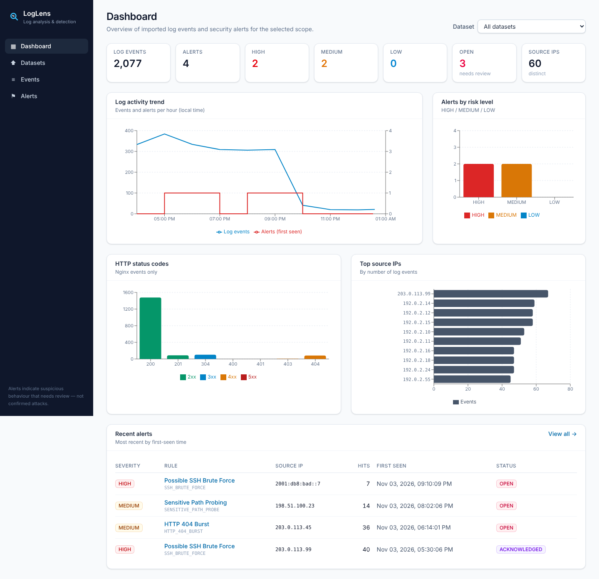
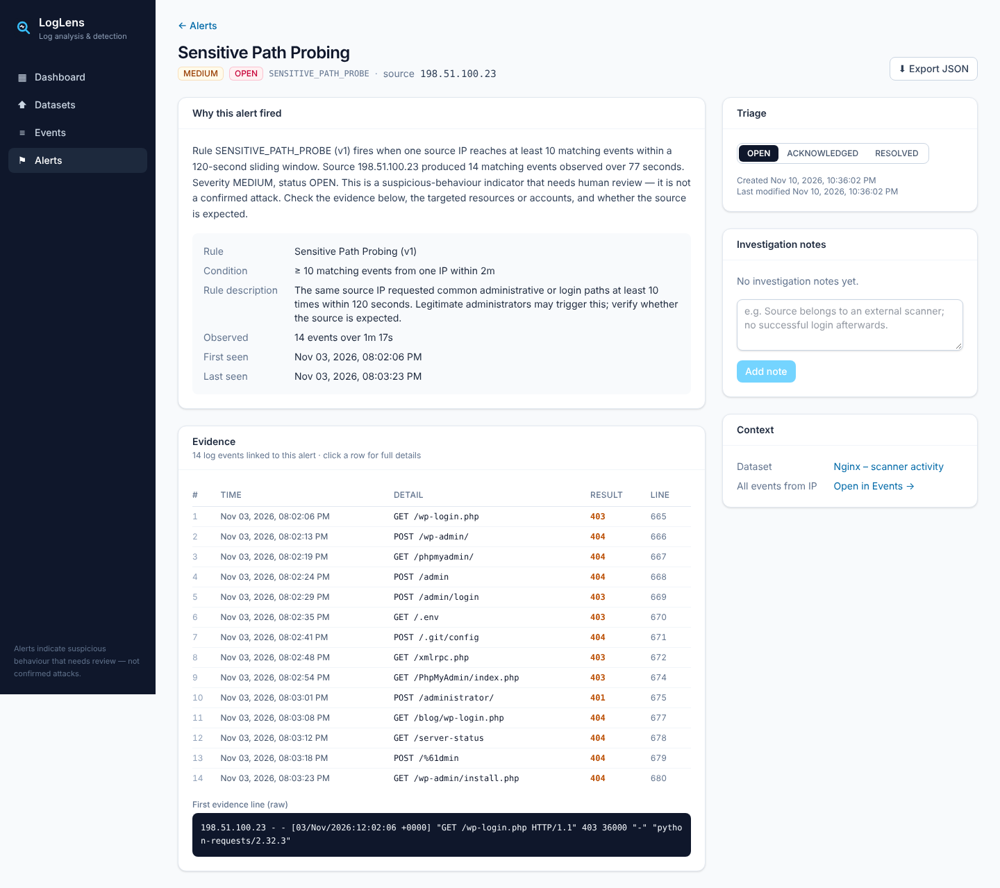
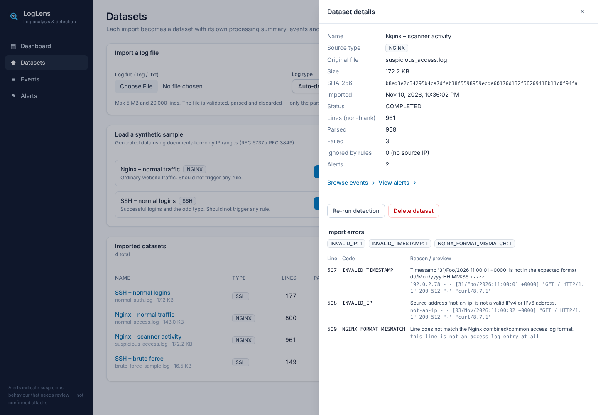
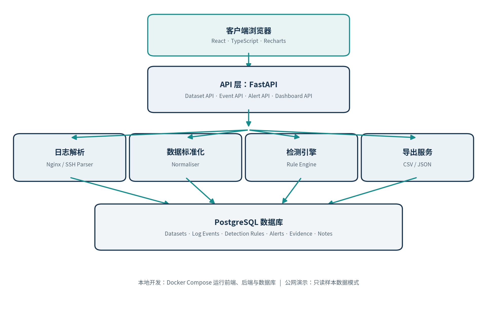
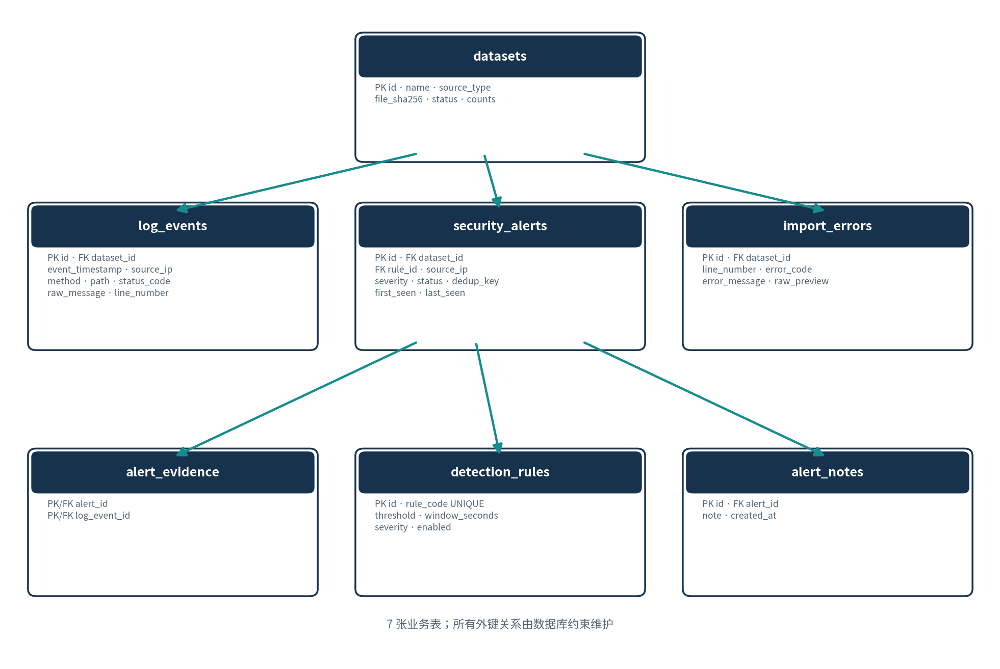

# LogLens

**Lightweight log analysis and security event detection platform.**
Import Nginx access logs or SSH authentication logs, get them parsed and normalised, run explainable detection rules, and investigate every alert down to the raw log lines that triggered it.

Built for IT students, developers and junior sysadmins who want to *understand* what their logs say — not a full SIEM.



| Alert investigation | Dataset processing summary |
|---|---|
|  |  |

## Key features

- **Import** `.log` / `.txt` files (≤ 5 MB, ≤ 20,000 lines) or one-click synthetic samples. Files are validated by *content* (binary, encoding, format sniffing), not just by extension.
- **Parse & normalise** Nginx `combined`/`common` logs and the documented SSH auth.log formats (ISO 8601 and classic syslog) into one event schema; IPv4/IPv6; everything stored in UTC.
- **Never lose an import to one bad line** – failed lines are recorded with line number, error code, reason and a bounded preview.
- **Three explainable rules** – SSH brute force (HIGH), HTTP 404 burst (MEDIUM), sensitive-path probing (MEDIUM), using a sliding time window with configurable thresholds.
- **Evidence-backed alerts** – each alert links to every log event that supports it; re-running detection is idempotent and preserves triage status and notes.
- **Dashboard** – totals, risk levels, HTTP status codes, top source IPs and an activity trend, all scoped to a selected dataset.
- **Investigation workflow** – filter alerts, view evidence and raw lines, set OPEN / ACKNOWLEDGED / RESOLVED, add notes.
- **Export** events to CSV (formula-injection safe) and alerts + evidence to JSON, always matching the current filters.
- **Public read-only demo mode** enforced on the server (`DEMO_READ_ONLY=true`).

## Architecture

A modular monolith: React SPA → FastAPI (routers → services → parsers / detection engine / exports) → PostgreSQL.



Details: [docs/architecture.md](docs/architecture.md)

## Technology stack

| Layer | Technology |
|---|---|
| Frontend | React 18, TypeScript, Vite 6, Tailwind CSS 4, Recharts, React Router |
| Backend | Python 3.12, FastAPI, Pydantic v2, SQLAlchemy 2, Alembic |
| Database | PostgreSQL 16 |
| Testing | Pytest, Vitest + Testing Library, Playwright |
| Delivery | Docker, Docker Compose, Nginx, GitHub Actions |

## Quick start (Docker)

Requires Docker Desktop (macOS / Windows) or Docker Engine (Linux).

```bash
git clone https://github.com/<you>/LogLens.git && cd LogLens
cp .env.example .env          # change POSTGRES_PASSWORD (in both places)
docker compose up --build -d
open http://localhost:8080    # API docs: http://localhost:8000/docs
```

Click **Load** on a sample on the dashboard, or upload your own log on **Datasets**.

## Development setup (macOS + VS Code)

Full step-by-step guide (Chinese): **[docs/macos-setup.zh-CN.md](docs/macos-setup.zh-CN.md)**

```bash
brew install git python@3.12 node@22      # plus Docker Desktop and VS Code
make setup                                # .env, backend/.venv, npm ci
make db-up && make migrate                # PostgreSQL in Docker + schema
make dev-backend                          # http://localhost:8000  (hot reload)
make dev-frontend                         # http://localhost:5173  (hot reload, proxies /api)
```

Open the folder in VS Code (`code .`) and accept the recommended extensions. The **Full stack (API + Vite)** launch configuration starts the database, runs migrations and debugs both servers with breakpoints. `make help` lists all commands.

## Database design

Seven tables: `datasets`, `log_events`, `detection_rules`, `security_alerts`, `alert_evidence`, `alert_notes`, `import_errors` — with cascading deletes from datasets, a composite key on evidence and a unique `dedup_key` for idempotent detection.



Details: [docs/database.md](docs/database.md)

## API

All endpoints are under `/api/v1`, documented interactively at **`/docs`** (Swagger UI). Summary and error codes: [docs/API.md](docs/API.md). Ready-made requests for VS Code REST Client: [`api.http`](api.http).

## Detection rules

| Rule | Condition | Window | Severity |
|---|---|---|---|
| `SSH_BRUTE_FORCE` | ≥ 5 failed SSH passwords from one IP | 300 s | HIGH |
| `HTTP_404_BURST` | ≥ 20 HTTP 404 responses to one IP | 120 s | MEDIUM |
| `SENSITIVE_PATH_PROBE` | ≥ 10 requests to admin/login/secret paths from one IP | 120 s | MEDIUM |

Alerts are indicators for review — **not confirmed attacks**. Algorithm, known false positives and tests: [docs/detection-rules.md](docs/detection-rules.md). Supported formats: [docs/log-formats.md](docs/log-formats.md).

## Testing

```bash
make test             # 100 backend tests (SQLite) + 23 frontend tests
make test-backend-pg  # the backend suite against PostgreSQL
make e2e              # Playwright: import → alert → evidence → triage → export
make lint             # ruff + eslint + tsc
make perf             # performance check on your machine
```

Measured on a 2-vCPU Linux VM with PostgreSQL 16: a 20,000-line (3.5 MB) import takes **≈ 2.3 s** (target ≤ 30 s) and the dashboard summary responds in **≈ 48 ms median** (target ≤ 2 s). Traceability from acceptance criteria to tests and all covered edge cases: [docs/testing.md](docs/testing.md).

## Public read-only demo

```bash
make demo   # seeds synthetic samples and starts with DEMO_READ_ONLY=true
```

All write endpoints return `403 DEMO_READ_ONLY`; the UI shows a banner and disables write controls. Hosting guide (managed PostgreSQL + container web service + static site) and pre-launch checklist: [docs/deployment.md](docs/deployment.md).

## Project structure

```
LogLens/
├── backend/
│   ├── app/
│   │   ├── api/v1/          # routers: datasets, events, alerts, dashboard, exports
│   │   ├── core/            # config, errors, rate limiting
│   │   ├── database/        # SQLAlchemy models, session
│   │   ├── schemas/         # Pydantic models
│   │   ├── services/        # dataset, event, alert, dashboard, export services
│   │   │   ├── parsers/     # nginx_parser.py, ssh_parser.py
│   │   │   └── detection/   # rules.py, engine.py
│   │   └── scripts/         # seed_samples.py
│   ├── alembic/             # migrations
│   └── tests/               # pytest
├── frontend/
│   ├── src/{components,features,pages,hooks,services,types,lib}
│   └── e2e/                 # Playwright
├── sample_data/             # synthetic logs (documentation IP ranges only)
├── scripts/                 # sample generator, perf check
├── docs/                    # SRS, architecture, database, API, rules, testing, deployment
├── .vscode/                 # recommended extensions, debug configs, tasks
├── docker-compose.yml       # db + backend + frontend
└── Makefile
```

## Privacy

Use synthetic or properly anonymised logs. Uploaded files are processed in memory and not stored; parsed events (which may contain IPs and usernames) are stored in your local database until you delete the dataset. The bundled samples only use RFC 5737 / RFC 3849 documentation addresses.

## Future work

- **V1.1** – rule thresholds editable in the UI, more log formats, false-positive test sets, chart improvements.
- **V2.0 (SentinelLite)** – real-time ingestion and collectors, multiple sources, notifications, accounts and roles, Wazuh integration, background job queue.
- **V2.5** – AI-assisted alert explanations, event correlation, MITRE ATT&CK mapping and report generation — keeping rule evidence and human judgement in the loop.

## Documentation

[SRS (v1.1)](docs/SRS.md) · [macOS setup](docs/macos-setup.zh-CN.md) · [Architecture](docs/architecture.md) · [Database](docs/database.md) · [API](docs/API.md) · [Detection rules](docs/detection-rules.md) · [Log formats](docs/log-formats.md) · [Testing](docs/testing.md) · [Deployment](docs/deployment.md)
