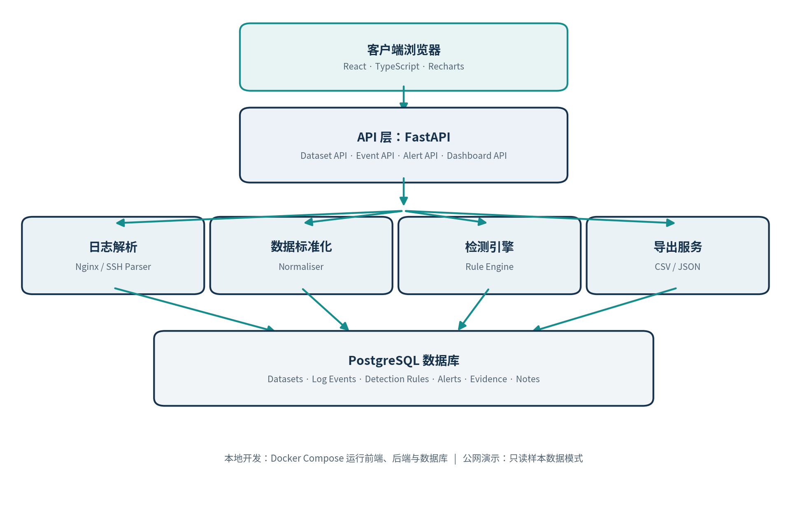
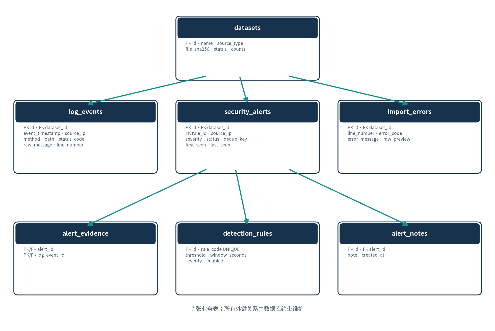

**LOGLENS**

**轻量级日志分析与安全事件检测平台**

项目开发方案 · 软件需求规格说明书（SRS）

|     |
|-----|

| **文档版本** | 1.1（开发环境改为 macOS）                |
|--------------|------------------------------------------|
| **编制日期** | 2026 年 11 月 10 日                      |
| **项目类型** | 个人 ICT 全栈项目                        |
| **目标环境** | macOS + VS Code + Docker；本地与公网演示 |
| **预算原则** | 零预算优先，使用开源工具                 |
| **开发周期** | 首版规划 6 周，约 30–45 小时             |

**目标：交付一个可运行、可测试、可部署、可解释的真实软件作品**

# 文档说明

本文件整合 LogLens 的项目定位、范围边界、软件需求规格、技术架构、数据库设计、API 规划、安全设计、测试策略、部署方案及六周开发任务。它既是项目启动文档，也是开发过程中的验收依据。

<table>
<colgroup>
<col style="width: 100%" />
</colgroup>
<thead>
<tr class="header">
<th>
<strong>开发原则</strong>

先完成一个边界清晰、端到端可用的 V1.0，再逐步扩展为 SentinelLite 安全监控平台。优先保证正确性、可维护性和可演示性，不以堆叠技术栈为目标。
</th>
</tr>
</thead>
<tbody>
</tbody>
</table>

# 目录

- 1\. 项目概述与定位

- 2\. 项目范围与用户场景

- 3\. 软件需求规格说明书（SRS）

- 4\. 系统技术架构

- 5\. 数据库设计

- 6\. API 接口设计

- 7\. 检测规则与算法设计

- 8\. 项目目录与 Git 工作流

- 9\. macOS 开发环境

- 10\. 本地与公网部署方案

- 11\. 测试与验收标准

- 12\. 六周开发计划与任务清单

- 13\. GitHub 作品集与简历呈现

- 14\. 风险、限制与后续路线

- 附录 A：开发启动检查清单

- 附录 B：关键术语

文档使用说明：需求编号（FR / NFR / AC）可直接用于 GitHub Issues、任务看板和测试用例追踪。若开发过程中修改需求，应同步更新本文件与 README。

# 1. 项目概述与定位

## 1.1 项目简介

LogLens（Lightweight Log Analysis and Security Event Detection Platform）是一款面向 IT 学生、软件开发者和初级系统管理员的轻量级 Web 应用。用户可导入 Nginx Access Log 和预设格式的 Linux SSH 认证日志；系统解析并标准化记录，执行基础规则检测，生成可追溯的安全告警，并通过 Dashboard 展示分析结果。

## 1.2 项目目标

- 完成一个真实可用的全栈 Web 产品，而非单独的算法练习或静态网页。

- 实践 Python 后端、React 前端、关系型数据库、日志处理、规则引擎和容器化部署。

- 让每条安全告警都能追溯到触发规则和原始日志证据。

- 支持本地完整功能与公网只读演示，便于开发、测试和简历展示。

- 采用模块化单体架构，为后续实时采集、更多检测规则和 AI 辅助分析预留扩展空间。

## 1.3 对个人求职作品集的价值

| **能力维度** | **项目中的体现**                  | **可展示的证据**         |
|--------------|-----------------------------------|--------------------------|
| **软件工程** | 需求拆解、模块分层、API、异常处理 | SRS、代码结构、接口文档  |
| **后端开发** | FastAPI、SQLAlchemy、数据验证     | API 演示、后端测试       |
| **前端开发** | React、TypeScript、图表和筛选交互 | Dashboard 截图、演示视频 |
| **数据库**   | 关系设计、外键、索引、迁移        | ER 图、Alembic 迁移      |
| **网络安全** | 日志理解、暴力破解和异常访问检测  | 规则逻辑、告警证据       |
| **DevOps**   | Docker、Compose、部署配置         | 一键启动说明、公开 Demo  |
| **测试能力** | 单元、集成、端到端测试            | 测试报告、CI 记录        |

## 1.4 项目成功定义

V1.0 的成功不是“功能越多越好”，而是用户能够从导入一份日志开始，顺利完成解析、检测、查看证据、管理告警和导出结果的完整流程；他人能按照 README 在自己的环境启动项目，并能理解系统的架构和设计理由。

# 2. 项目范围与用户场景

## 2.1 目标用户

| **用户类型**   | **主要需求**                           |
|----------------|----------------------------------------|
| IT 学生        | 学习日志解析、规则检测和全栈系统开发。 |
| 软件开发人员   | 快速查看 Web 应用访问记录和错误状态。  |
| 初级系统管理员 | 发现异常登录、异常访问和可疑请求模式。 |
| 网络安全初学者 | 理解告警原因、检测阈值和证据链。       |

## 2.2 核心使用流程

> **1.** 用户打开应用，选择预置样本或上传支持的日志文件。
>
> **2.** 后端校验文件格式、大小和内容，再逐行解析。
>
> **3.** 解析成功的记录被转换为统一事件结构并写入数据库；失败行单独记录原因。
>
> **4.** 检测引擎按规则和时间窗口评估事件，生成安全告警并关联证据。
>
> **5.** Dashboard 展示统计信息；用户可搜索日志、筛选告警、查看证据和更新状态。
>
> **6.** 用户按当前筛选条件导出 CSV 或 JSON。

## 2.3 V1.0 范围边界

| **V1.0 必须完成**              | **V1.0 暂不实现**        |
|--------------------------------|--------------------------|
| Nginx Access Log 导入          | 实时服务器日志采集       |
| 预设 SSH 认证日志导入          | 网络抓包与流量分析       |
| 日志解析、标准化和错误记录     | 自动封锁 IP 或自动响应   |
| 三种基础规则检测和告警证据     | 分布式日志处理和消息队列 |
| Dashboard、事件检索和告警管理  | 机器学习威胁分类         |
| CSV / JSON 导出                | AI 自动调查或自动处置    |
| Docker 本地运行、公网只读 Demo | 复杂多租户及企业级 RBAC  |

<table>
<colgroup>
<col style="width: 100%" />
</colgroup>
<thead>
<tr class="header">
<th>
<strong>范围控制</strong>

V1.0 不开发完整 SIEM，也不做实时采集。每新增功能都应先判断是否会影响六周交付；非必要功能进入 Future Work。
</th>
</tr>
</thead>
<tbody>
</tbody>
</table>

## 2.4 文件和数据限制

| **项目**     | **V1.0 设定**                              |
|--------------|--------------------------------------------|
| 文件扩展名   | .log、.txt                                 |
| 最大文件大小 | 5 MB                                       |
| 最大处理行数 | 20,000 行                                  |
| 支持来源     | NGINX、预设 SSH 格式                       |
| 错误行处理   | 跳过并记录行号、错误原因和有限长度预览     |
| 原始上传文件 | 默认临时处理，不长期保存原文件             |
| 时间存储     | 数据库统一存 UTC；界面按浏览器本地时区显示 |

# 3. 软件需求规格说明书（SRS）

## 3.1 文档目的

本节定义 LogLens V1.0 的功能需求、非功能需求、业务规则、假设条件与验收标准。需求编号用于开发追踪、测试和版本管理。

## 3.2 产品概述与运行环境

| **项目** | **说明**                       |
|----------|--------------------------------|
| 产品形态 | 独立的客户端—服务器 Web 应用   |
| 前端     | React + TypeScript + Vite      |
| 后端     | Python + FastAPI               |
| 数据库   | PostgreSQL                     |
| 迁移工具 | Alembic                        |
| 容器化   | Docker + Docker Compose        |
| 开发环境 | macOS 13+ + VS Code + Docker Desktop |
| 浏览器   | Chrome、Edge、Firefox 近期版本 |
| 部署     | 本地 Docker；公网只读演示环境  |

## 3.3 功能需求

### A. 数据集管理

| **编号**  | **需求名称** | **需求描述**                                                                             |
|-----------|--------------|------------------------------------------------------------------------------------------|
| **FR-01** | 上传日志文件 | 系统允许本地模式用户上传支持的 .log 或 .txt 文件；单文件最大 5 MB、最多处理 20,000 行。  |
| **FR-02** | 文件验证     | 校验扩展名、大小、编码和可读内容；不得仅凭扩展名判断类型；拒绝二进制文件和不支持的格式。 |
| **FR-03** | 数据集管理   | 用户可查看数据集列表和详情、查看处理统计、删除数据集及其关联记录。                       |
| **FR-04** | 处理摘要     | 展示文件名、来源类型、总行数、成功解析数、失败数、告警数和处理状态。                     |

### B. 日志处理

| **编号**  | **需求名称** | **需求描述**                                                                                                               |
|-----------|--------------|----------------------------------------------------------------------------------------------------------------------------|
| **FR-05** | Nginx 解析   | 提取时间、来源 IP、HTTP 方法、请求路径、状态码、User-Agent 和原始日志。                                                    |
| **FR-06** | SSH 解析     | 识别约定样本格式中的 Failed password、Accepted password、Invalid user 等记录，并提取时间、IP、用户名及认证结果（可用时）。 |
| **FR-07** | 数据标准化   | 将不同来源转换为统一事件结构，并保留原始日志文本。                                                                         |
| **FR-08** | 解析错误处理 | 单行失败不得终止整个导入；记录行号、错误码、原因和受限长度的原始内容预览。                                                 |

### C. 安全检测

| **编号**  | **需求名称** | **需求描述**                                                             |
|-----------|--------------|--------------------------------------------------------------------------|
| **FR-09** | 规则检测     | 提供 SSH 暴力破解、HTTP 404 突增、敏感路径探测三种规则。                 |
| **FR-10** | 风险等级     | 告警支持 HIGH、MEDIUM、LOW 三档风险等级。                                |
| **FR-11** | 告警生成     | 告警保存规则、来源 IP、等级、首次/末次时间、命中次数、摘要和证据关联。   |
| **FR-12** | 检测幂等     | 同一数据集重复运行同一规则时，不产生重复告警；应稳定更新或重建对应告警。 |
| **FR-13** | 告警解释     | 说明触发规则、阈值、时间窗口及关联证据；不得将可疑行为表述为已确认攻击。 |

### D. Dashboard 与事件浏览

| **编号**  | **需求名称** | **需求描述**                                                                       |
|-----------|--------------|------------------------------------------------------------------------------------|
| **FR-14** | 主 Dashboard | 显示日志事件总数、告警总数、各级告警数量、不同来源 IP 数、近期告警和日志活动趋势。 |
| **FR-15** | 图表展示     | 展示风险等级分布、HTTP 状态码分布、日志活动趋势和高频来源 IP。                     |
| **FR-16** | 数据集筛选   | 选择数据集后，Dashboard 所有统计均按所选范围更新。                                 |
| **FR-17** | 空状态       | 无数据时显示产品说明、样本加载入口和导入指引。                                     |
| **FR-18** | 事件列表     | 展示时间、来源 IP、日志来源、HTTP 方法、路径和状态码等可用字段。                   |
| **FR-19** | 事件筛选     | 支持按数据集、来源 IP、时间范围、状态码和日志来源筛选。                            |
| **FR-20** | 服务端分页   | 事件列表必须分页，避免一次性把全部事件载入浏览器。                                 |
| **FR-21** | 事件详情     | 允许查看单条事件的原始日志和标准化字段。                                           |

### E. 告警管理

| **编号**  | **需求名称** | **需求描述**                                                |
|-----------|--------------|-------------------------------------------------------------|
| **FR-22** | 告警列表     | 查看所有已生成告警。                                        |
| **FR-23** | 告警筛选     | 支持按风险等级、状态、来源 IP、检测规则和数据集筛选。       |
| **FR-24** | 告警状态     | 支持 OPEN、ACKNOWLEDGED、RESOLVED 三种状态。                |
| **FR-25** | 告警调查     | 查看告警描述、规则、证据日志、来源 IP、时间范围和严重程度。 |
| **FR-26** | 调查备注     | 允许本地用户添加告警调查备注。                              |
| **FR-27** | 告警时间记录 | 保存告警创建时间和最后修改时间。                            |

### F. 数据导出与公共演示

| **编号**  | **需求名称** | **需求描述**                                                              |
|-----------|--------------|---------------------------------------------------------------------------|
| **FR-28** | CSV 导出     | 支持导出当前筛选范围内的事件；对 CSV 字段进行正确转义，降低公式注入风险。 |
| **FR-29** | JSON 导出    | 支持导出告警详情和关联证据。                                              |
| **FR-30** | 导出范围     | 导出结果必须遵循当前数据集和筛选条件。                                    |
| **FR-31** | 公共访问     | 公网演示无需注册即可查看预置样本数据。                                    |
| **FR-32** | 预置样本     | 公网环境提供合成日志及预先计算的告警结果。                                |
| **FR-33** | 只读模式     | 公网 Demo 禁止上传文件、删除数据集、修改告警状态和添加备注。              |
| **FR-34** | 环境配置     | 通过环境变量切换本地开发模式与公共只读演示模式。                          |

## 3.4 非功能需求

| **编号**   | **类别** | **要求**                                                              |
|------------|----------|-----------------------------------------------------------------------|
| **NFR-01** | 性能     | 在记录并说明测试硬件的环境中，5 MB 测试文件建议在 30 秒内完成处理。   |
| **NFR-02** | 性能     | 对最多 20,000 条记录的数据集，Dashboard 汇总请求通常应在 2 秒内响应。 |
| **NFR-03** | 性能     | 事件列表使用服务端分页与数据库查询，不将全量数据发送到浏览器。        |
| **NFR-04** | 安全     | 上传文件必须先校验再处理；不得执行上传内容。                          |
| **NFR-05** | 安全     | 数据库访问使用 ORM 参数化机制或参数化查询。                           |
| **NFR-06** | 安全     | 不可信日志内容在前端以文本方式渲染，禁止直接插入 HTML。               |
| **NFR-07** | 安全     | 数据库密码、密钥和部署配置通过环境变量提供，不提交到 Git。            |
| **NFR-08** | 安全     | 公网模式禁用所有写操作；生产访问必须使用 HTTPS。                      |
| **NFR-09** | 安全     | CORS 只允许配置的前端来源；上传端点配置大小和频率限制。               |
| **NFR-10** | 可靠性   | 单条日志解析失败不得使整批导入中断。                                  |
| **NFR-11** | 可靠性   | 检测重复运行结果一致，不生成重复告警。                                |
| **NFR-12** | 可维护性 | 路由层、业务服务、解析器、检测逻辑和数据库模型分离。                  |
| **NFR-13** | 可维护性 | 数据库结构变更使用 Alembic 迁移管理。                                 |
| **NFR-14** | 可测试性 | 解析器、规则引擎和关键 API 必须有自动化测试。                         |
| **NFR-15** | 可用性   | 错误信息应解释问题及用户可采取的操作；关键图表有标题和图例。          |
| **NFR-16** | 可移植性 | 项目通过 Docker Compose 可在兼容的 Docker 环境启动。                  |

## 3.5 业务规则

| **规则编号** | **业务规则**                                                   |
|--------------|----------------------------------------------------------------|
| **BR-01**    | 数据集完成验证后才可进入解析流程。                             |
| **BR-02**    | 每条成功解析的日志事件必须关联一个数据集。                     |
| **BR-03**    | 每条告警必须关联一个检测规则。                                 |
| **BR-04**    | 每条告警必须具有风险等级和状态。                               |
| **BR-05**    | 删除数据集时必须级联删除事件、告警、证据、备注及导入错误记录。 |
| **BR-06**    | 告警必须能够关联支持其触发的原始事件证据。                     |
| **BR-07**    | 公共演示模式不得执行写操作。                                   |
| **BR-08**    | 所有数据库时间戳使用 UTC 存储，前端按浏览器本地时区展示。      |
| **BR-09**    | 告警统计与 Dashboard 统计必须使用一致的数据集筛选范围。        |
| **BR-10**    | 规则阈值和时间窗口应由配置确定，不能散落硬编码于 API 路由。    |

## 3.6 假设与约束

- 第一版以单用户本地使用为主，不实现复杂的登录和权限管理。

- SSH 日志解析仅保证兼容项目提供的约定样本格式，不承诺覆盖所有 Linux 发行版和系统日志变体。

- 日志时间戳格式必须可识别；无时区时间的解释规则应在解析器中明确配置。

- 检测规则用于识别需要调查的可疑行为，不构成攻击定性或自动处置。

- 上传数据可能包含 IP、用户名或其他敏感信息；测试和公开演示必须使用合成数据。

- 免费云服务额度、休眠策略和数据库保留期限可能变化，正式部署前需重新核对服务商条款。

## 3.7 验收标准

| **编号**  | **验收条件**                                    |
|-----------|-------------------------------------------------|
| **AC-01** | 有效 Nginx 日志可成功上传和导入。               |
| **AC-02** | 支持格式的 SSH 样本日志可被识别。               |
| **AC-03** | 成功解析的记录存入 PostgreSQL。                 |
| **AC-04** | 错误行会被记录，且不会终止整批处理。            |
| **AC-05** | 三条检测规则均能由准备好的测试数据触发。        |
| **AC-06** | 每条告警均展示检测依据和关联事件。              |
| **AC-07** | Dashboard 统计与数据库查询结果一致。            |
| **AC-08** | 事件支持筛选和分页。                            |
| **AC-09** | 本地模式可修改告警状态和添加备注。              |
| **AC-10** | CSV / JSON 导出包含正确的数据范围。             |
| **AC-11** | Docker Compose 可启动完整本地系统。             |
| **AC-12** | 公网演示可通过浏览器访问预置样本。              |
| **AC-13** | 公网模式无法写入、删除或修改数据。              |
| **AC-14** | 核心解析器、检测规则和关键 API 具有自动化测试。 |
| **AC-15** | 英文 README 包含安装、运行、架构和演示说明。    |

# 4. 系统技术架构

## 4.1 架构选择：模块化单体

V1.0 采用模块化单体（Modular Monolith）：前端、后端和数据库分别部署，但后端业务逻辑作为一个应用运行。当前数据规模和个人开发资源不足以证明微服务的收益；拆分微服务会额外引入服务发现、网络通信、分布式事务和部署维护成本。

<table>
<colgroup>
<col style="width: 100%" />
</colgroup>
<thead>
<tr class="header">
<th>
<strong>架构原则</strong>

先做好模块边界，再考虑服务拆分。解析器、规则引擎、数据集服务和告警服务通过清晰的函数/服务接口协作。
</th>
</tr>
</thead>
<tbody>
</tbody>
</table>

## 4.2 系统架构图

*图 1：LogLens V1.0 模块化单体架构*

## 4.3 技术选型

| **层级**   | **技术**                  | **选择理由**                                   |
|------------|---------------------------|------------------------------------------------|
| 前端       | React + TypeScript + Vite | 已有基础；适合组件化界面、类型约束和快速开发。 |
| UI 样式    | Tailwind CSS              | 快速建立一致的布局、颜色和间距规范。           |
| 图表       | Recharts                  | 适合展示告警等级、状态码和时间趋势。           |
| 后端       | Python + FastAPI          | 开发效率高，便于日志处理和后续数据/AI 扩展。   |
| 数据校验   | Pydantic                  | 定义请求、响应及配置结构，减少无效输入。       |
| ORM        | SQLAlchemy 2.x            | 通过模型和会话管理数据库访问。                 |
| 数据库迁移 | Alembic                   | 可追踪、可回滚地管理数据库结构变化。           |
| 数据库     | PostgreSQL                | 适合结构化数据、外键、索引和聚合查询。         |
| 后端测试   | Pytest                    | 验证解析器、规则和 API。                       |
| 前端测试   | Vitest                    | 验证组件和前端逻辑。                           |
| 端到端测试 | Playwright                | 验证上传至告警展示的完整流程。                 |
| 部署       | Docker + Docker Compose   | 统一本地开发与部署运行环境。                   |
| 版本控制   | Git + GitHub              | 记录开发过程并形成可检查的作品集。             |

## 4.4 后端模块职责

| **模块**   | **建议文件**            | **职责**                               |
|------------|-------------------------|----------------------------------------|
| Dataset    | dataset_service.py      | 文件验证、导入编排、数据集状态和删除。 |
| Parser     | parsers/nginx_parser.py | 解析 Nginx Access Log。                |
| Parser     | parsers/ssh_parser.py   | 解析约定 SSH 认证日志。                |
| Normaliser | normaliser.py           | 将不同来源转换成统一事件字段。         |
| Detection  | detection/engine.py     | 运行规则、组织证据和处理幂等。         |
| Detection  | detection/rules.py      | 定义规则编号、阈值、窗口及等级。       |
| Alert      | alert_service.py        | 告警查询、状态更新和调查备注。         |
| Dashboard  | dashboard_service.py    | 提供统计聚合和趋势数据。               |
| Export     | export_service.py       | 按筛选条件生成 CSV / JSON。            |

## 4.5 数据处理流程

> **1.** 接收文件：校验扩展名、大小、编码、内容和用户选择的来源类型。
>
> **2.** 解析阶段：逐行处理；解析器返回结构化事件或明确的错误结果。
>
> **3.** 标准化阶段：字段名称、时间格式、IP 地址和来源类型统一。
>
> **4.** 入库阶段：按批次写入事件，记录成功/失败计数；控制事务大小。
>
> **5.** 检测阶段：针对本次数据集运行规则，生成告警及证据关系。
>
> **6.** 汇总阶段：更新数据集处理状态和统计；前端刷新 Dashboard。

# 5. 数据库设计

## 5.1 设计原则

- 使用 PostgreSQL 保存结构化事件、告警和处理元数据。

- 主业务表使用 UUID；高频事件表使用 BIGINT 自增主键以便排序和存储。

- 通过外键和级联删除维护数据完整性。

- 时间使用 TIMESTAMPTZ 并以 UTC 存储。

- 原始日志内容保存在 log_events.raw_message，便于复核；上传原始文件默认不长期保存。

- 常用筛选字段建立索引，避免仅靠全表扫描。

## 5.2 实体关系图

*图 2：LogLens 核心数据库实体关系图（7 张表）*

## 5.3 核心数据表

下列字段是 V1.0 的建议结构。实际实现时，应以 SQLAlchemy 模型和 Alembic 迁移为准；字段类型可以根据实现细节微调，但不要改变核心关系。

### 5.3.1 datasets

| **字段**              | **类型**     | **约束 / 说明**                                     |
|-----------------------|--------------|-----------------------------------------------------|
| **id**                | UUID         | PK；数据集唯一标识                                  |
| **name**              | VARCHAR(150) | NOT NULL；界面显示名称                              |
| **source_type**       | VARCHAR(30)  | NOT NULL；NGINX / SSH                               |
| **original_filename** | VARCHAR(255) | NOT NULL；原始文件名                                |
| **file_sha256**       | CHAR(64)     | NOT NULL；文件哈希，可用于重复文件识别              |
| **size_bytes**        | BIGINT       | NOT NULL；文件大小                                  |
| **total_lines**       | INTEGER      | NOT NULL；总行数                                    |
| **parsed_lines**      | INTEGER      | NOT NULL；成功解析行数                              |
| **failed_lines**      | INTEGER      | NOT NULL；失败行数                                  |
| **status**            | VARCHAR(20)  | NOT NULL；PENDING / PROCESSING / COMPLETED / FAILED |
| **created_at**        | TIMESTAMPTZ  | NOT NULL；创建时间                                  |

### 5.3.2 log_events

| **字段**            | **类型**     | **约束 / 说明**                           |
|---------------------|--------------|-------------------------------------------|
| **id**              | BIGINT       | PK；事件 ID                               |
| **dataset_id**      | UUID         | FK → datasets.id；NOT NULL                |
| **event_timestamp** | TIMESTAMPTZ  | NOT NULL；事件时间                        |
| **source_type**     | VARCHAR(30)  | NOT NULL；日志来源                        |
| **source_ip**       | VARCHAR(45)  | 可空；兼容 IPv4 / IPv6 文本格式           |
| **http_method**     | VARCHAR(10)  | 可空                                      |
| **request_path**    | TEXT         | 可空                                      |
| **status_code**     | SMALLINT     | 可空                                      |
| **user_agent**      | TEXT         | 可空                                      |
| **username**        | VARCHAR(120) | 可空                                      |
| **auth_result**     | VARCHAR(20)  | 可空；SUCCESS / FAILURE / INVALID_USER 等 |
| **raw_message**     | TEXT         | NOT NULL；原始日志行                      |
| **line_number**     | INTEGER      | NOT NULL；原文件行号                      |
| **created_at**      | TIMESTAMPTZ  | NOT NULL；入库时间                        |

### 5.3.3 detection_rules

| **字段**                    | **类型**     | **约束 / 说明**     |
|-----------------------------|--------------|---------------------|
| **id**                      | UUID         | PK                  |
| **rule_code**               | VARCHAR(60)  | UNIQUE、NOT NULL    |
| **name**                    | VARCHAR(150) | NOT NULL            |
| **description**             | TEXT         | 规则解释            |
| **source_type**             | VARCHAR(30)  | 适用来源            |
| **threshold**               | INTEGER      | 触发阈值            |
| **window_seconds**          | INTEGER      | 时间窗口秒数        |
| **severity**                | VARCHAR(20)  | HIGH / MEDIUM / LOW |
| **enabled**                 | BOOLEAN      | 是否启用            |
| **created_at / updated_at** | TIMESTAMPTZ  | 创建和更新时间      |

### 5.3.4 security_alerts

| **字段**                    | **类型**     | **约束 / 说明**                   |
|-----------------------------|--------------|-----------------------------------|
| **id**                      | UUID         | PK                                |
| **dataset_id**              | UUID         | FK → datasets.id；NOT NULL        |
| **rule_id**                 | UUID         | FK → detection_rules.id；NOT NULL |
| **source_ip**               | VARCHAR(45)  | 来源 IP                           |
| **severity**                | VARCHAR(20)  | 风险等级                          |
| **status**                  | VARCHAR(20)  | OPEN / ACKNOWLEDGED / RESOLVED    |
| **occurrence_count**        | INTEGER      | 命中次数                          |
| **first_seen / last_seen**  | TIMESTAMPTZ  | 观测时间范围                      |
| **summary**                 | TEXT         | 告警摘要                          |
| **dedup_key**               | VARCHAR(200) | UNIQUE；用于同数据集重复检测幂等  |
| **created_at / updated_at** | TIMESTAMPTZ  | 创建和最后修改时间                |

### 5.3.5 alert_evidence

| **字段**         | **类型** | **约束 / 说明**                      |
|------------------|----------|--------------------------------------|
| **alert_id**     | UUID     | PK 组成部分；FK → security_alerts.id |
| **log_event_id** | BIGINT   | PK 组成部分；FK → log_events.id      |

组合主键为 (alert_id, log_event_id)，避免同一事件重复关联到同一告警。

### 5.3.6 alert_notes

| **字段**       | **类型**    | **约束 / 说明**                   |
|----------------|-------------|-----------------------------------|
| **id**         | UUID        | PK                                |
| **alert_id**   | UUID        | FK → security_alerts.id；NOT NULL |
| **note**       | TEXT        | NOT NULL；调查备注                |
| **created_at** | TIMESTAMPTZ | NOT NULL                          |

### 5.3.7 import_errors

| **字段**          | **类型**     | **约束 / 说明**            |
|-------------------|--------------|----------------------------|
| **id**            | BIGINT       | PK                         |
| **dataset_id**    | UUID         | FK → datasets.id；NOT NULL |
| **line_number**   | INTEGER      | 原文件行号                 |
| **error_code**    | VARCHAR(60)  | 错误类型                   |
| **error_message** | TEXT         | 错误说明                   |
| **raw_preview**   | VARCHAR(500) | 受限长度原始内容预览       |
| **created_at**    | TIMESTAMPTZ  | 创建时间                   |

## 5.4 关系与删除策略

| **关系**                          | **基数** | **删除策略建议**                     |
|-----------------------------------|----------|--------------------------------------|
| datasets → log_events             | 1 : N    | 删除数据集时级联删除事件             |
| datasets → security_alerts        | 1 : N    | 删除数据集时级联删除告警             |
| datasets → import_errors          | 1 : N    | 删除数据集时级联删除错误记录         |
| detection_rules → security_alerts | 1 : N    | 规则被告警引用时限制删除；可停用规则 |
| security_alerts → alert_evidence  | 1 : N    | 删除告警时级联删除证据关系           |
| log_events → alert_evidence       | 1 : N    | 删除事件时级联删除证据关系           |
| security_alerts → alert_notes     | 1 : N    | 删除告警时级联删除备注               |

## 5.5 索引建议

- log_events(dataset_id, event_timestamp)：按数据集和时间范围查询。

- log_events(source_ip)：按来源 IP 搜索。

- log_events(status_code)：按 HTTP 状态码过滤。

- security_alerts(dataset_id, severity, status)：Dashboard 和告警筛选。

- security_alerts(dedup_key)：确保检测幂等。

- import_errors(dataset_id, line_number)：按数据集定位错误行。

# 6. API 接口设计

## 6.1 API 约定

| **项目** | **约定**                                                   |
|----------|------------------------------------------------------------|
| 统一前缀 | /api/v1                                                    |
| 数据格式 | JSON；文件上传使用 multipart/form-data                     |
| 时间格式 | ISO 8601；接口返回 UTC 时间戳                              |
| 分页     | page、page_size；服务端分页                                |
| 过滤     | 通过 query parameters 提供筛选条件                         |
| 错误响应 | 统一返回 error_code、message 和可选 details                |
| 状态码   | 遵循 HTTP 常见语义：200、201、204、400、404、413、422、500 |

## 6.2 API 清单

| **方法** | **Endpoint**                | **用途**                 |
|----------|-----------------------------|--------------------------|
| GET      | /health                     | 健康检查                 |
| GET      | /api/v1/datasets            | 数据集列表               |
| POST     | /api/v1/datasets/upload     | 上传日志                 |
| GET      | /api/v1/datasets/{id}       | 数据集详情               |
| DELETE   | /api/v1/datasets/{id}       | 删除数据集               |
| GET      | /api/v1/events              | 查询事件；支持过滤和分页 |
| GET      | /api/v1/events/{id}         | 事件详情                 |
| GET      | /api/v1/alerts              | 查询告警；支持过滤和分页 |
| GET      | /api/v1/alerts/{id}         | 告警详情和证据           |
| PATCH    | /api/v1/alerts/{id}/status  | 更新告警状态             |
| POST     | /api/v1/alerts/{id}/notes   | 添加调查备注             |
| GET      | /api/v1/dashboard/summary   | Dashboard 汇总           |
| GET      | /api/v1/exports/events.csv  | 导出 CSV                 |
| GET      | /api/v1/exports/alerts.json | 导出 JSON                |

## 6.3 请求与响应示例

上传文件：POST /api/v1/datasets/upload，使用 multipart/form-data。

<table>
<colgroup>
<col style="width: 100%" />
</colgroup>
<thead>
<tr class="header">
<th>file: sample_nginx.log 
source_type: NGINX</th>
</tr>
</thead>
<tbody>
</tbody>
</table>

成功响应示例：

<table>
<colgroup>
<col style="width: 100%" />
</colgroup>
<thead>
<tr class="header">
<th>{ 
"dataset_id": "example-uuid", 
"status": "COMPLETED", 
"total_lines": 1000, 
"parsed_lines": 980, 
"failed_lines": 20, 
"alerts_generated": 3 
}</th>
</tr>
</thead>
<tbody>
</tbody>
</table>

Dashboard 汇总示例：GET /api/v1/dashboard/summary?dataset_id={id}

<table>
<colgroup>
<col style="width: 100%" />
</colgroup>
<thead>
<tr class="header">
<th>{ 
"total_events": 980, 
"total_alerts": 3, 
"high_alerts": 1, 
"medium_alerts": 2, 
"low_alerts": 0, 
"unique_source_ips": 15 
}</th>
</tr>
</thead>
<tbody>
</tbody>
</table>

状态更新示例：PATCH /api/v1/alerts/{id}/status

<table>
<colgroup>
<col style="width: 100%" />
</colgroup>
<thead>
<tr class="header">
<th>{ 
"status": "ACKNOWLEDGED" 
}</th>
</tr>
</thead>
<tbody>
</tbody>
</table>

<table>
<colgroup>
<col style="width: 100%" />
</colgroup>
<thead>
<tr class="header">
<th>
<strong>接口设计提醒</strong>

API 路由只处理 HTTP 层职责。文件验证、解析、规则执行、数据库写入和导出逻辑应放在 service 层，避免路由函数过度膨胀。
</th>
</tr>
</thead>
<tbody>
</tbody>
</table>

# 7. 检测规则与算法设计

## 7.1 通用检测模型

V1.0 使用可解释的规则检测。规则引擎读取标准化事件，以来源 IP、事件类型和时间窗口聚合计数；当阈值达到条件时生成告警，并保存命中事件作为证据。规则阈值仅为演示和学习用途，需要通过测试样本验证误报情况。

## 7.2 初始规则

| **规则编号**         | **触发条件**                    | **窗口** | **建议等级** | **说明**                             |
|----------------------|---------------------------------|----------|--------------|--------------------------------------|
| SSH_BRUTE_FORCE      | 同一 IP 的 SSH 失败认证次数 ≥ 5 | 300 秒   | HIGH         | 识别短时间连续认证失败。             |
| HTTP_404_BURST       | 同一 IP 的 HTTP 404 次数 ≥ 20   | 120 秒   | MEDIUM       | 识别异常密集的不存在路径请求。       |
| SENSITIVE_PATH_PROBE | 同一 IP 访问敏感路径次数 ≥ 10   | 120 秒   | MEDIUM       | 识别对常见管理或登录路径的集中探测。 |

敏感路径初始清单可包含 /admin、/wp-login.php、/phpmyadmin。合法网站也可能使用这些路径，因此触发结果只能说明“需要调查”，不能直接认定入侵。

## 7.3 SSH 暴力破解检测流程

> **1.** 过滤 source_type=SSH 且 auth_result=FAILURE 的事件。
>
> **2.** 按照 source_ip 分组并按 event_timestamp 升序排列。
>
> **3.** 对每个 IP 使用滑动时间窗口维护最近 300 秒的失败事件。
>
> **4.** 当窗口中的失败次数达到 5 次时，创建 HIGH 告警。
>
> **5.** 将窗口内相关 log_event_id 写入 alert_evidence。
>
> **6.** 使用稳定 dedup_key 避免同一次检测结果重复创建告警。

## 7.4 Nginx 规则检测流程

- HTTP 404 规则：按来源 IP 对状态码为 404 的事件进行时间窗口计数。

- 敏感路径规则：匹配规范化 request_path，再按 IP 和窗口统计命中数。

- 规则应忽略缺失 IP 或时间戳无效的事件，并在处理摘要中统计不可用记录。

- 同一数据集重跑检测时，对该数据集对应的规则结果进行事务化替换或稳定更新。

## 7.5 告警解释示例

<table>
<colgroup>
<col style="width: 100%" />
</colgroup>
<thead>
<tr class="header">
<th>
<strong>示例：Possible SSH Brute Force</strong>

来源 IP：192.0.2.10；检测规则：SSH_BRUTE_FORCE；命中次数：5；观测窗口：120 秒；结果：HIGH / OPEN。解释：同一来源在配置的 5 分钟检测窗口内出现至少 5 次 SSH 认证失败。建议检查来源 IP、用户账号和相关认证记录。该告警是可疑行为提示，不是已确认攻击。
</th>
</tr>
</thead>
<tbody>
</tbody>
</table>

## 7.6 检测质量要求

- 为每条规则准备正例和负例测试数据。

- 验证时间窗口边界，例如 5 次事件刚好落在窗口内外的情况。

- 验证跨数据集事件不会被错误合并。

- 验证同一来源 IP 不同检测规则分别产生独立告警。

- 在文档中记录规则版本、阈值、窗口和已知误报场景。

# 8. 项目目录与 Git 工作流

## 8.1 推荐目录结构

<table>
<colgroup>
<col style="width: 100%" />
</colgroup>
<thead>
<tr class="header">
<th>LogLens/ 
├── backend/ 
│ ├── app/ 
│ │ ├── main.py 
│ │ ├── api/v1/ # datasets, events, alerts, dashboard, exports 
│ │ ├── core/ # config.py 
│ │ ├── database/ # connection.py, models.py 
│ │ ├── schemas/ # dataset.py, event.py, alert.py 
│ │ ├── services/ 
│ │ │ ├── parsers/ # nginx_parser.py, ssh_parser.py 
│ │ │ ├── detection/ # engine.py, rules.py 
│ │ │ ├── dataset_service.py 
│ │ │ ├── alert_service.py 
│ │ │ └── export_service.py 
│ │ └── tests/ # test_parsers.py, test_detection.py, test_api.py 
│ ├── alembic/ 
│ ├── requirements.txt 
│ └── Dockerfile 
├── frontend/ 
│ ├── src/ 
│ │ ├── components/ 
│ │ ├── features/ # dashboard, datasets, events, alerts 
│ │ ├── pages/ 
│ │ ├── services/ 
│ │ ├── hooks/ 
│ │ ├── types/ 
│ │ └── App.tsx 
│ ├── package.json 
│ └── Dockerfile 
├── sample_data/ 
│ ├── nginx/ # normal_access.log, suspicious_access.log 
│ └── ssh/ # normal_auth.log, brute_force_sample.log 
├── docs/ # SRS.md, architecture.md, database.md, API.md 
├── docker-compose.yml 
├── .env.example 
├── .gitignore 
└── README.md</th>
</tr>
</thead>
<tbody>
</tbody>
</table>

## 8.2 Git 分支建议

| **分支**                 | **用途**                                                      |
|--------------------------|---------------------------------------------------------------|
| main                     | 稳定、可演示版本；只合并经过基本测试的内容。                  |
| develop                  | 日常集成分支；单人开发也可简化为直接从 main 建 feature 分支。 |
| feature/log-parser       | 日志解析功能开发。                                            |
| feature/detection-engine | 检测引擎开发。                                                |
| feature/dashboard        | 前端 Dashboard 开发。                                         |
| bugfix/parser-error      | 缺陷修复。                                                    |

## 8.3 Commit 信息规范

<table>
<colgroup>
<col style="width: 100%" />
</colgroup>
<thead>
<tr class="header">
<th>feat: implement nginx log parser 
feat: add ssh authentication detection 
feat: create security alert dashboard 
fix: handle invalid timestamp in log parser 
test: add brute force detection tests 
docs: update installation instructions</th>
</tr>
</thead>
<tbody>
</tbody>
</table>

单人项目不必严格执行复杂 Git Flow；关键是提交粒度清楚、变更目的明确、main 分支保持可运行。

# 9. macOS 开发环境

> **v1.1 变更：** 开发环境由 Windows + WSL 2 改为 macOS（Apple Silicon 或 Intel）+ VS Code。macOS 本身是类 Unix 系统，不再需要 WSL；Docker Desktop for Mac 直接提供容器环境。完整的逐步安装说明见 [macos-setup.zh-CN.md](macos-setup.zh-CN.md)。

## 9.1 推荐环境

| **组件** | **用途** | **配置建议** |
|---|---|---|
| macOS 13+（Apple Silicon / Intel） | 主机操作系统 | 本项目所有镜像（python:3.12-slim、node:22-alpine、nginx、postgres:16-alpine）均有 arm64 版本，无需 Rosetta。 |
| Homebrew | 包管理器 | 安装 git、python@3.12、node@22。 |
| Visual Studio Code | 编辑器 | 打开仓库后按提示安装 `.vscode/extensions.json` 中的推荐扩展（Python、Pylance、Ruff、ESLint、Prettier、Tailwind、Vitest、Playwright、Containers、SQLTools）。 |
| Docker Desktop for Mac（或 OrbStack） | 容器环境 | 运行 PostgreSQL 和完整 Compose 栈。 |
| Git | 版本管理 | 配置用户名、邮箱和 SSH key（`ssh-keygen -t ed25519`）。 |
| Python 3.12 / Node.js 22 | 本机开发工具 | 版本写在 `.python-version` 与 `.nvmrc`；后端使用 `backend/.venv` 虚拟环境。 |

## 9.2 初始化步骤

> **1.** 安装 Xcode Command Line Tools：`xcode-select --install`。
>
> **2.** 安装 Homebrew，再执行 `brew install git python@3.12 node@22`。
>
> **3.** 安装 Docker Desktop for Mac 并启动，验证 `docker run --rm hello-world`。
>
> **4.** 安装 VS Code，在命令面板执行 “Shell Command: Install 'code' command in PATH”。
>
> **5.** 克隆项目到 `~/Projects/LogLens`，执行 `code .` 打开，并安装推荐扩展。
>
> **6.** 执行 `make setup && make db-up && make migrate`，验证数据库连接与 `/health`。

## 9.3 GPU 的使用定位

LogLens V1.0 不需要 GPU。Mac 上的 Docker 容器无法使用 Apple GPU（Metal），这对本项目没有影响。后续 KnowFlow AI 项目如需本地推理，可直接在 macOS 上使用 Ollama / MLX 等原生工具，而不是在容器中访问 GPU。

# 10. 本地与公网部署方案

## 10.1 本地完整模式

本地模式用于开发、测试和完整功能演示。推荐通过 Docker Compose 启动前端、后端和 PostgreSQL。开发期间也可以独立运行 Vite 和 Uvicorn，以便热更新。

| **服务** | **技术**                                      | **建议端口**               | **说明**                         |
|----------|-----------------------------------------------|----------------------------|----------------------------------|
| Frontend | React / Vite；生产容器可由 Nginx 提供静态文件 | 5173（开发）/ 8080（容器） | 浏览器访问入口。                 |
| Backend  | FastAPI / Uvicorn                             | 8000                       | 只对本地或容器网络暴露必要接口。 |
| Database | PostgreSQL                                    | 5432                       | 生产容器不应直接暴露到公网。     |

<table>
<colgroup>
<col style="width: 100%" />
</colgroup>
<thead>
<tr class="header">
<th># 启动完整本地环境 
docker compose up --build 
 
# 停止容器（保留命名卷） 
docker compose down 
 
# 确认容器状态 
docker compose ps</th>
</tr>
</thead>
<tbody>
</tbody>
</table>

建议使用 Docker named volume 保存本地 PostgreSQL 数据；不要把数据库数据目录提交到 Git。正式部署前需提供 Alembic 迁移和样本数据初始化命令。

## 10.2 公网只读 Demo 模式

公网演示的目标是让招聘人员和其他开发者能通过浏览器查看产品，而不是开放匿名用户上传和修改数据。建议采用静态前端 + FastAPI Web Service + 托管 PostgreSQL 的基础架构。Render 可作为前端/后端候选托管平台，Neon 可作为 PostgreSQL 候选服务；免费额度、休眠策略、数据保留和使用条款会变化，部署前必须核对当前官方说明。

*图 3：应用逻辑架构；公网部署时将持久化数据库替换为托管 PostgreSQL*

| **配置项**     | **本地模式**    | **公网 Demo 模式**            |
|----------------|-----------------|-------------------------------|
| 查看 Dashboard | 允许            | 允许                          |
| 查看样本日志   | 允许            | 允许                          |
| 上传日志       | 允许            | 关闭                          |
| 运行检测       | 允许            | 展示预先计算的结果            |
| 修改告警状态   | 允许            | 关闭                          |
| 添加备注       | 允许            | 关闭                          |
| 删除数据集     | 允许            | 关闭                          |
| 数据库         | 本地 PostgreSQL | 托管 PostgreSQL；只读访问为主 |

## 10.3 环境变量

<table>
<colgroup>
<col style="width: 100%" />
</colgroup>
<thead>
<tr class="header">
<th>APP_ENV=development 
DEMO_READ_ONLY=false 
DATABASE_URL=postgresql+psycopg://user:password@db:5432/loglens 
CORS_ORIGINS=http://localhost:5173 
MAX_UPLOAD_SIZE_MB=5 
MAX_LOG_LINES=20000 
LOG_LEVEL=INFO</th>
</tr>
</thead>
<tbody>
</tbody>
</table>

上述内容仅为 .env.example 中的变量名示意。真实凭据必须通过本地 .env 或平台 Secret 管理功能注入；.env 文件应加入 .gitignore。

## 10.4 公网部署安全要求

- 公网只提供合成样本数据，不上传或展示真实个人、企业或学校日志。

- 后端对写操作进行服务端强制拦截，不能只依赖前端隐藏按钮。

- 数据库不公开暴露端口；仅允许后端服务通过安全连接访问。

- 启用 HTTPS，配置精确 CORS 来源和合理的请求速率限制。

- 不要在日志中打印数据库密码、Secret、完整上传内容或不必要的敏感字段。

- 部署前执行依赖更新、配置检查、API 安全测试和备份验证。

# 11. 测试与验收标准

## 11.1 测试层次

| **测试层次**        | **测试对象**               | **建议工具**     | **示例**                                |
|---------------------|----------------------------|------------------|-----------------------------------------|
| Unit Testing        | 解析器、时间窗口、检测规则 | Pytest           | 无效时间戳、阈值边界、IPv6 输入。       |
| Integration Testing | API、数据库和迁移          | Pytest + Test DB | 上传文件后检查数据集、事件、告警关系。  |
| Frontend Testing    | 组件和前端状态             | Vitest           | 筛选器、分页、空状态和错误提示。        |
| End-to-End          | 端到端用户工作流           | Playwright       | 导入样本 → 告警展示 → 查看证据 → 导出。 |

## 11.2 测试数据集

| **数据集**               | **内容**                                   | **预期结果**                   |
|--------------------------|--------------------------------------------|--------------------------------|
| Dataset A：正常日志      | 正常 Web 访问、正常 SSH 登录               | 不应触发对应异常规则。         |
| Dataset B：SSH 暴力破解  | 同 IP 短时间 5 次以上失败认证              | 触发 SSH_BRUTE_FORCE。         |
| Dataset C：HTTP 404 突增 | 同 IP 在 120 秒内产生 20 次以上 404        | 触发 HTTP_404_BURST。          |
| Dataset D：混合场景      | 正常流量、SSH 失败、404 和敏感路径请求混合 | 多条规则分别触发，证据不交叉。 |

## 11.3 必测边界情况

- 空文件、超大文件、错误编码、二进制文件和不支持的日志格式。

- 日志含缺失 IP、缺失时间、异常路径、特殊字符或超长 User-Agent。

- 阈值正好达到、低于 1 次、超过阈值，以及事件刚好跨越窗口边界。

- 同一文件重复导入、同一数据集重复运行检测、删除数据集后的关联记录。

- 分页最后一页、无搜索结果、无告警状态和数据库暂时不可用。

- 公网模式下直接调用 POST、PATCH、DELETE 接口，确认服务端拒绝。

## 11.4 性能目标

| **指标**                     | **目标**     | **测量方式**                              |
|------------------------------|--------------|-------------------------------------------|
| 5 MB 文件处理                | 建议 ≤ 30 秒 | 记录测试硬件、文件内容和解析/检测总耗时。 |
| 20,000 条事件 Dashboard 汇总 | 通常 ≤ 2 秒  | 通过 API 压测或重复请求记录中位数和 P95。 |
| 浏览器事件列表               | 服务端分页   | 确认网络响应仅包含当前页数据。            |

上述是项目目标，不是未经测试的性能承诺。最终 README 应记录实际测试环境、数据集规模、运行时间及测试方法。

# 12. 六周开发计划与任务清单

按每周投入 5–10 小时估算，V1.0 目标总投入约 30–45 小时。时间仅为计划基准，若某阶段验收未通过，应先完成该阶段，不为赶进度跳过测试。

## 第 1 周：项目初始化与架构验证

**预计投入：5–6 小时**

- ☐ 创建 GitHub Repository 和 README 初稿。

- ☐ 建立 backend、frontend、docs、sample_data 目录。

- ☐ 安装/验证 Homebrew、Python 3.12、Node.js 22、VS Code、Docker Desktop for Mac 和 Git。

- ☐ 初始化 React + TypeScript + Vite。

- ☐ 初始化 FastAPI 应用和 /health。

- ☐ 用 Docker Compose 启动 PostgreSQL 并验证连接。

- ☐ 提交第一版基础架构代码。

<table>
<colgroup>
<col style="width: 100%" />
</colgroup>
<thead>
<tr class="header">
<th>
<strong>本周验收</strong>

验收：前端、后端能够启动；后端健康检查可用；PostgreSQL 可连接。
</th>
</tr>
</thead>
<tbody>
</tbody>
</table>

## 第 2 周：数据库与日志解析

**预计投入：6–8 小时**

- ☐ 定义 SQLAlchemy 数据模型。

- ☐ 配置 Alembic 并生成初始迁移。

- ☐ 准备正常 Nginx 与 SSH 合成样本。

- ☐ 实现 Nginx Parser。

- ☐ 实现约定 SSH Parser。

- ☐ 实现统一 Normalised Event 数据结构。

- ☐ 实现解析错误记录和统计。

- ☐ 为解析器编写 Pytest。

<table>
<colgroup>
<col style="width: 100%" />
</colgroup>
<thead>
<tr class="header">
<th>
<strong>本周验收</strong>

验收：样本日志解析后能够保存至 PostgreSQL；无效行会记录原因。
</th>
</tr>
</thead>
<tbody>
</tbody>
</table>

## 第 3 周：安全检测引擎

**预计投入：6–8 小时**

- ☐ 建立 detection_rules 初始配置。

- ☐ 实现 SSH 暴力破解时间窗口检测。

- ☐ 实现 HTTP 404 突增检测。

- ☐ 实现敏感路径探测检测。

- ☐ 实现 security_alerts 和 alert_evidence 写入。

- ☐ 设计 dedup_key 和重复执行策略。

- ☐ 为每条规则编写正例、负例和窗口边界测试。

<table>
<colgroup>
<col style="width: 100%" />
</colgroup>
<thead>
<tr class="header">
<th>
<strong>本周验收</strong>

验收：测试数据可触发正确告警，证据准确，重复执行不产生重复告警。
</th>
</tr>
</thead>
<tbody>
</tbody>
</table>

## 第 4 周：后端 API 与前端主体

**预计投入：6–8 小时**

- ☐ 完成 Dataset API 和处理摘要。

- ☐ 完成 Event API、筛选与分页。

- ☐ 完成 Alert API 和 Dashboard API。

- ☐ 定义统一 API 响应和错误结构。

- ☐ 开发 Dashboard 主页面和统计卡片。

- ☐ 开发数据集管理和事件列表界面。

- ☐ 连接真实 API 数据。

<table>
<colgroup>
<col style="width: 100%" />
</colgroup>
<thead>
<tr class="header">
<th>
<strong>本周验收</strong>

验收：浏览器可以查看数据库真实数据，核心列表可筛选和分页。
</th>
</tr>
</thead>
<tbody>
</tbody>
</table>

## 第 5 周：完整交互与导出

**预计投入：5–8 小时**

- ☐ 完成告警列表、详情和证据展示。

- ☐ 完成告警状态更新及调查备注。

- ☐ 实现 CSV 事件导出。

- ☐ 实现 JSON 告警导出。

- ☐ 实现空状态、加载状态和错误提示。

- ☐ 完成前端组件测试和关键 API 集成测试。

- ☐ 检查 CSV 注入防护和不可信日志文本渲染。

<table>
<colgroup>
<col style="width: 100%" />
</colgroup>
<thead>
<tr class="header">
<th>
<strong>本周验收</strong>

验收：用户可以从日志定位告警、调查证据、更新状态并导出结果。
</th>
</tr>
</thead>
<tbody>
</tbody>
</table>

## 第 6 周：测试、部署与作品集整理

**预计投入：5–7 小时**

- ☐ 完成 Docker Compose 一键启动流程。

- ☐ 测试本地全功能部署及数据库持久化。

- ☐ 配置 DEMO_READ_ONLY 公网模式。

- ☐ 准备纯合成的公开样本数据。

- ☐ 部署静态前端、后端和托管 PostgreSQL。

- ☐ 进行端到端测试和公网写操作拒绝测试。

- ☐ 完成英文 README、架构图、ER 图和演示视频。

- ☐ 整理简历项目描述和技术难点总结。

<table>
<colgroup>
<col style="width: 100%" />
</colgroup>
<thead>
<tr class="header">
<th>
<strong>本周验收</strong>

验收：项目可本地启动、可公网只读访问，文档和演示材料完整。
</th>
</tr>
</thead>
<tbody>
</tbody>
</table>

## 12.1 每周里程碑总览

| **周次** | **可演示成果**                           |
|----------|------------------------------------------|
| Week 1   | 项目骨架启动，前后端和数据库互通。       |
| Week 2   | 一份日志成功解析并保存。                 |
| Week 3   | 模拟安全行为触发正确告警。               |
| Week 4   | Dashboard 展示真实统计与事件记录。       |
| Week 5   | 完成告警调查、状态处理和导出。           |
| Week 6   | 本地完整部署、公网只读 Demo 和项目文档。 |

# 13. GitHub 作品集与简历呈现

## 13.1 仓库首页内容顺序

> **1.** Project Overview：一句话说明解决的问题及目标用户。
>
> **2.** Screenshots / Demo GIF：展示 Dashboard、事件列表和告警详情。
>
> **3.** Key Features：列出导入、解析、检测、告警和导出能力。
>
> **4.** System Architecture：放置系统架构图。
>
> **5.** Technology Stack：清楚列出前端、后端、数据库和部署技术。
>
> **6.** Installation Guide：提供从克隆仓库到启动服务的完整步骤。
>
> **7.** Database Design：展示 ER 图和关键表说明。
>
> **8.** API Documentation：提供接口说明或 FastAPI Swagger 地址。
>
> **9.** Testing：介绍测试数据、测试命令和已验证的边界条件。
>
> **10.** Future Work：列出下一版本计划。

## 13.2 简历项目描述模板（完成后填写）

<table>
<colgroup>
<col style="width: 100%" />
</colgroup>
<thead>
<tr class="header">
<th>
<strong>英文简历标题</strong>

LogLens — Lightweight Log Analysis &amp; Security Event Detection Platform
</th>
</tr>
</thead>
<tbody>
</tbody>
</table>

- Designed and developed a full-stack log analysis platform using Python, FastAPI, React, TypeScript, PostgreSQL, and Docker.

- Implemented structured log parsing and normalisation for Nginx access logs and sample SSH authentication logs.

- Built a configurable rule-based detection engine to identify brute-force login attempts, HTTP 404 bursts, and sensitive-path probing.

- Developed an interactive dashboard and alert investigation workflow with event evidence, filtering, pagination, and data export.

- Containerised the application and prepared a read-only public demo with synthetic datasets.

简历描述必须以真实完成情况为准。未实现的功能、未测量的性能指标、虚构的准确率或用户数量不得写入。

## 13.3 建议录制的演示流程

> **1.** 展示首页和项目定位。
>
> **2.** 导入预置混合日志样本。
>
> **3.** 展示解析成功/失败统计。
>
> **4.** 打开 Dashboard 观察统计。
>
> **5.** 进入 SSH 告警，解释规则和时间窗口。
>
> **6.** 打开证据日志，说明告警可追溯性。
>
> **7.** 修改告警状态并导出 JSON。
>
> **8.** 展示 Docker Compose 启动方式和 GitHub README。

# 14. 风险、限制与后续路线

## 14.1 项目风险与应对

| **风险**         | **影响**                   | **应对措施**                                               |
|------------------|----------------------------|------------------------------------------------------------|
| 范围不断扩大     | 首版无法按期完成。         | 冻结 V1.0 范围；新需求放入后续版本。                       |
| SSH 日志格式多样 | 解析失败率增加。           | 明确支持样本格式；解析器按来源分离并编写测试。             |
| 规则误报         | 用户误以为告警是确定攻击。 | 展示规则和原始证据；使用“可疑行为”措辞；记录已知限制。     |
| 上传文件风险     | 恶意或异常文件影响服务。   | 限制大小和行数、内容校验、临时处理、超时限制、不执行文件。 |
| 公开 API 被滥用  | 服务不可用或数据被修改。   | 公网 Demo 服务端强制只读，启用速率限制和 HTTPS。           |
| 免费云服务变更   | 公开 Demo 可能休眠或受限。 | 部署前核对当前额度；保留本地 Docker 一键运行方案。         |
| 单人开发时间有限 | 任务延误。                 | 先保证解析、规则、Dashboard 和部署主链路，非核心功能延后。 |

## 14.2 版本路线图

| **版本** | **规划功能**                                                         | **目标**                                   |
|----------|----------------------------------------------------------------------|--------------------------------------------|
| V1.0     | 文件导入、解析、三条规则、Dashboard、告警管理、导出、本地与公网 Demo | 完成基础可展示产品。                       |
| V1.1     | 规则阈值配置、更多日志格式、图表改进、误报测试集                     | 提高可配置性和检测质量。                   |
| V2.0     | 实时日志接入、服务器采集端、多数据源、通知、账号权限、Wazuh 集成     | 扩展为轻量安全监控平台 SentinelLite。      |
| V2.5     | AI 辅助告警解释、事件关联、MITRE ATT&CK 映射、调查报告生成           | 加入 AI 辅助分析但保留规则证据和人工判断。 |

## 14.3 作品集整体路线

| **顺序**  | **项目**     | **重点证明的能力**                         | **与 LogLens 的关系** |
|-----------|--------------|--------------------------------------------|-----------------------|
| 1         | LogLens      | 全栈开发、日志处理、规则检测、数据库、部署 | 核心入门项目          |
| 2         | SentinelLite | 实时采集、告警关联、扩展检测、AI 辅助调查  | LogLens 的自然升级    |
| 3         | KnowFlow AI  | 本地 LLM、RAG、向量检索、答案评估          | 独立 AI 应用项目      |
| 4（可选） | IoT Nexus    | MQTT、设备通信、数据流和异常监测           | 补充网络与嵌入式方向  |

# 附录 A：开发启动检查清单

开始第一周前，请逐项确认环境与仓库准备情况。

| **完成** | **准备事项**                                   |
|----------|------------------------------------------------|
| ☐        | 安装 Xcode Command Line Tools 与 Homebrew。    |
| ☐        | `brew install git python@3.12 node@22`。       |
| ☐        | 安装并启动 Docker Desktop for Mac。            |
| ☐        | 安装 VS Code、`code` 命令和推荐扩展。          |
| ☐        | 安装 Git 并配置身份信息。                      |
| ☐        | 确认 Docker 可以启动一个测试容器。             |
| ☐        | 创建 LogLens GitHub Repository。               |
| ☐        | 创建项目根目录和 README 初稿。                 |
| ☐        | 确认 Docker Compose 可以启动 PostgreSQL。      |
| ☐        | 确认 FastAPI 的 /health 接口可以返回健康状态。 |

# 附录 B：关键术语

| **术语**         | **说明**                                                 |
|------------------|----------------------------------------------------------|
| API              | 应用程序编程接口；前端通过 API 与后端交换数据。          |
| Dataset          | 一次导入形成的数据集及其处理统计。                       |
| Log Parser       | 把原始日志文本转换为结构化字段的组件。                   |
| Normalisation    | 将不同来源的日志转换为统一的数据格式。                   |
| Detection Rule   | 基于条件、阈值和时间窗口识别可疑行为的规则。             |
| Alert            | 检测规则触发后产生、需要人工复核的安全告警。             |
| Evidence         | 支持告警结论的原始日志事件。                             |
| Idempotency      | 同一操作重复执行仍保持一致结果，不产生重复副作用。       |
| Modular Monolith | 单个应用内部按业务模块分层组织，而非拆成多个独立微服务。 |
| Demo Mode        | 只用于公开展示的只读模式，使用合成数据。                 |
| RAG              | 检索增强生成；先检索相关资料，再由语言模型生成回答。     |

# 文档维护说明

本方案是 LogLens V1.0 的基线文档。开发过程中如对需求、API、数据库结构或部署策略做出重大调整，应更新版本号、修改日期和相关章节，并在 Git 提交中说明变更原因。建议在每周里程碑结束时，用本文件中的验收条件检查实际交付结果。

<table>
<colgroup>
<col style="width: 100%" />
</colgroup>
<thead>
<tr class="header">
<th>
<strong>最终交付目标</strong>

完成一个你能够独立讲解系统架构、解释检测算法、展示测试证据、在本地启动并向他人提供公开演示的完整 ICT 项目。
</th>
</tr>
</thead>
<tbody>
</tbody>
</table>
