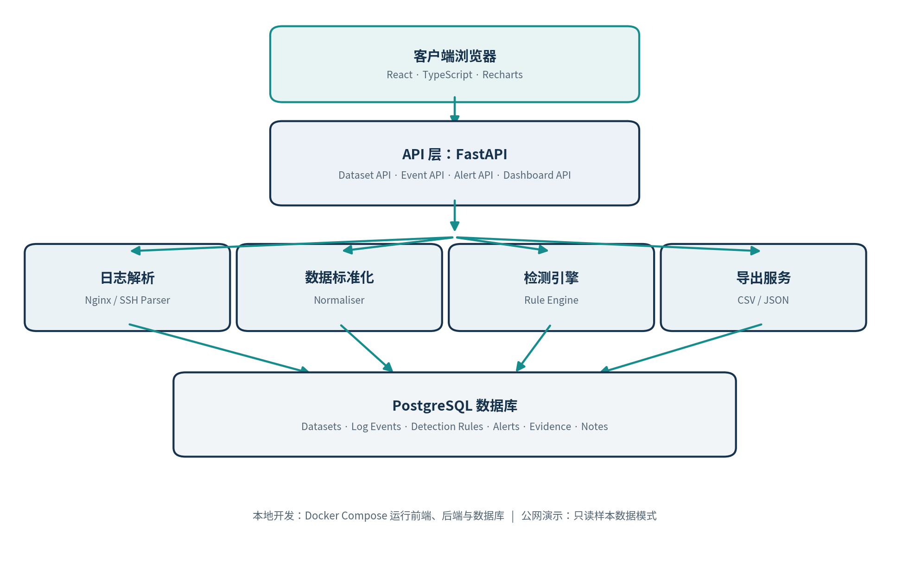
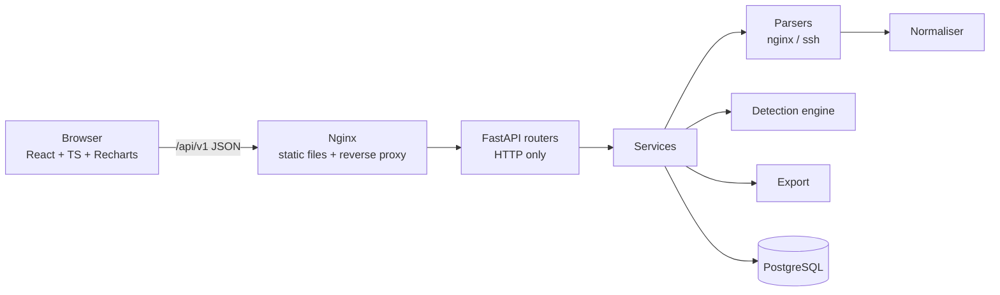

# Architecture

LogLens V1.0 is a **modular monolith**: the React SPA, the FastAPI application and PostgreSQL are deployed separately, but all backend business logic runs in one process with clear module boundaries. At this scale (≤ 20,000 lines per file, single user) microservices would add service discovery, network hops and distributed transactions without any benefit.

## Request flow

In development the Vite dev server replaces Nginx and proxies `/api` to Uvicorn on port 8000.

## Backend layers (NFR-12)

| Layer | Location | Responsibility |
|---|---|---|
| Routers | `app/api/v1/*.py` | Parse HTTP input (FastAPI/Pydantic), call one service function, shape the response. No business logic. |
| Schemas | `app/schemas/` | Pydantic request/response models; UTC ISO-8601 serialisation (BR-08). |
| Services | `app/services/*_service.py` | Orchestration: validation, import, queries, status changes, exports. |
| Parsers | `app/services/parsers/` | One module per source; each line → `NormalisedEvent` **or** `ParseFailure` (never raises). |
| Normaliser | `app/services/normaliser.py` | Shared event structure, IP canonicalisation, UTC conversion, bounded previews. |
| Detection | `app/services/detection/` | `rules.py` = definitions & thresholds (BR-10); `engine.py` = pure sliding-window algorithm + idempotent persistence. |
| Database | `app/database/` | SQLAlchemy 2.x models and session; schema changes only via Alembic (NFR-13). |
| Core | `app/core/` | Settings from env vars, unified error model, rate limiter. |

## Import pipeline (SRS §4.5)

1. **Receive** – the router reads at most `MAX_UPLOAD_SIZE_MB + 1` bytes; larger bodies are rejected without buffering.
2. **Validate** (`file_validation.py`) – extension whitelist, size, empty file, binary sniffing (NUL / control-byte ratio), strict UTF-8 decoding, line limit, and **content sniffing** of the first 50 lines against the chosen format (≥ 20 % must match). Only then is a `datasets` row created (BR-01).
3. **Parse & normalise** – line by line; failures are recorded in `import_errors` with line number, code, message and a ≤ 500-char preview (FR-08).
4. **Store** – bulk `INSERT` in batches of 2,000 rows.
5. **Detect** – all enabled rules for the dataset's source type run in the same transaction.
6. **Summarise** – counts and status (`COMPLETED`/`FAILED`) are committed; the API returns the processing summary.

Uploaded files are processed in memory and **never written to disk** or executed (NFR-04).

## Read-only demo mode (FR-33, BR-07, NFR-08)

`DEMO_READ_ONLY=true` installs an HTTP middleware that rejects every `POST/PUT/PATCH/DELETE` under `/api/` with `403 DEMO_READ_ONLY` — enforced on the server, not just by hiding buttons. The frontend reads `GET /api/v1/config` to hide/disable write controls and show a banner.

## Security controls

| Control | Where |
|---|---|
| Upload validation before processing; no execution of content | `file_validation.py` |
| Parameterised queries via SQLAlchemy ORM only | all services |
| Untrusted text rendered as React text nodes; `dangerouslySetInnerHTML` banned by ESLint | `frontend/eslint.config.js`, `RawLog` |
| CSV formula-injection neutralisation | `export_service.sanitize_cell` |
| Exact CORS origin list | `CORS_ORIGINS` |
| Upload rate limit (per client IP, per minute) | `core/rate_limit.py` |
| Security headers + CSP | `main.py`, `frontend/nginx.conf` |
| Secrets only via env / `.env` (git-ignored) | `core/config.py`, `.env.example` |
| Non-root container user; DB/API ports bound to 127.0.0.1 in Compose | `backend/Dockerfile`, `docker-compose.yml` |
| Filename sanitisation (path traversal) | `file_validation._safe_name` |

## Known limitations

* The rate limiter is in-memory, so it is per-process. Use a shared store (Redis) if you run several workers.
* Imports are synchronous inside the request. Fine for 5 MB / 20k lines (≈ 2 s measured). Larger files would need a background job queue (V2.0).
* SSH parsing is guaranteed only for the documented formats (see [log-formats.md](log-formats.md)).
