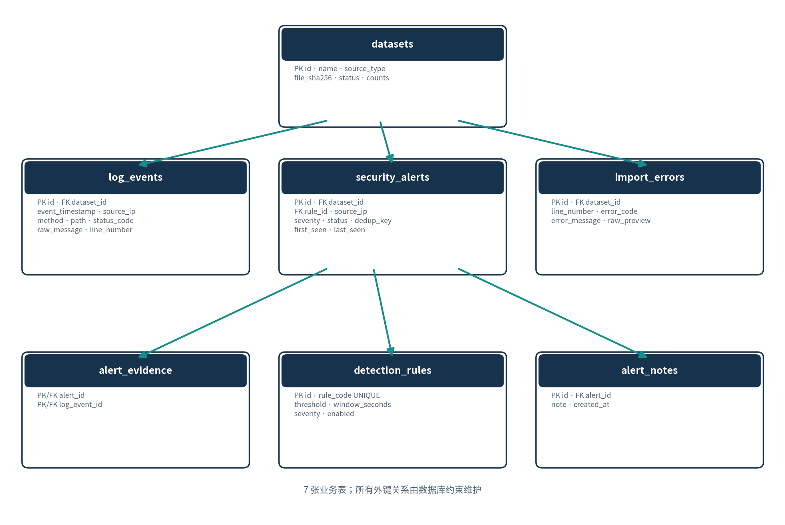
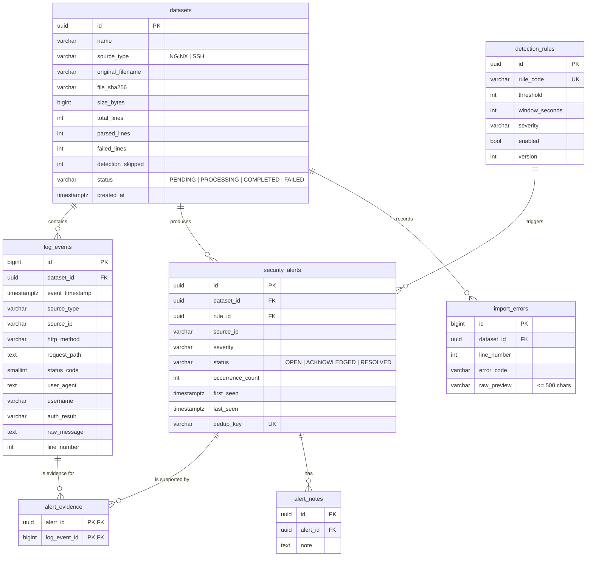

# Database design

PostgreSQL 16, managed with **Alembic** (`backend/alembic/versions/0001_initial_schema.py`). The migration is generated from the SQLAlchemy models, and CI runs `alembic check` to prove that models and migrations have not drifted.





## Design decisions

* **UUID** keys for business tables, **BIGINT** identity for high-volume `log_events` / `import_errors` (cheap to sort and index).
* All timestamps are `TIMESTAMPTZ` stored in UTC (BR-08); the UI converts to the browser's timezone.
* Enumerations are `VARCHAR` + `CHECK` constraints — portable and easy to migrate.
* `alert_evidence` has a composite PK `(alert_id, log_event_id)`, so an event cannot be linked twice to the same alert.
* `dedup_key` is `UNIQUE`; it encodes `dataset:rule:ip:first_event_id` and makes re-detection idempotent (FR-12).

### Additions beyond the SRS table list (non-breaking)

| Column | Why |
|---|---|
| `datasets.detection_skipped` | SRS §7.4: count events the rules had to ignore (no source IP). |
| `datasets.status_message` | Human-readable reason for `FAILED` / zero-parsed datasets. |
| `detection_rules.version` | SRS §7.6: record rule versions; shown in the UI and exports. |

## Delete strategy (BR-05)

| Relationship | ON DELETE |
|---|---|
| datasets → log_events / security_alerts / import_errors | CASCADE |
| security_alerts → alert_evidence / alert_notes | CASCADE |
| log_events → alert_evidence | CASCADE |
| detection_rules → security_alerts | **RESTRICT** (disable a rule instead of deleting it) |

`test_dataset_list_detail_and_cascade_delete` verifies that deleting a dataset leaves zero rows in all six dependent tables.

## Indexes

| Index | Serves |
|---|---|
| `log_events(dataset_id, event_timestamp)` | dataset + time-range queries, trend |
| `log_events(source_ip)` | IP search |
| `log_events(status_code)` | status filter |
| `security_alerts(dataset_id, severity, status)` | dashboard and alert filters |
| `security_alerts(dedup_key)` UNIQUE | idempotency |
| `import_errors(dataset_id, line_number)` | error list per dataset |
| `datasets(file_sha256)` | duplicate-file detection |

## Common commands

```bash
make migrate                                     # alembic upgrade head
cd backend && .venv/bin/alembic revision --autogenerate -m "describe change"
cd backend && .venv/bin/alembic downgrade -1
make db-shell                                    # psql
```
